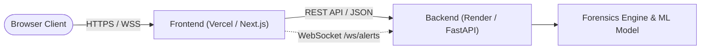

# 🚀 ShadowMem Deployment Guide (Split Deployment)

This guide walks you through deploying **ShadowMem** in a modern split-architecture:
- **Backend API & WebSockets**: Deployed on **Render** (or **Railway** / **Docker** / **Cloud VM**).
- **Frontend Dashboard**: Deployed on **Vercel** (or **Netlify** / **Cloudflare Pages**).

---

## 🏗️ Architecture Overview



---

## 📦 Part 1: Deploying the Backend (FastAPI + ML Model)

### Option A: Render (Recommended — Free & Easy)
The repository includes a ready-to-use [`render.yaml`](file:///C:/Users/Himesh/Desktop/ShadowMem/render.yaml) blueprint file.

1. **Push your code to GitHub / GitLab**.
2. Go to **[dashboard.render.com](https://dashboard.render.com)** and log in.
3. Click **New +** ➔ **Blueprint** (or **Web Service**).
4. Select your `ShadowMem` repository.
5. Render will automatically detect `render.yaml` or you can manually configure:
   - **Environment**: `Python 3` (or `Docker`)
   - **Build Command**: `pip install -r requirements.txt`
   - **Start Command**: `python -m uvicorn app:app --host 0.0.0.0 --port $PORT`
6. **Environment Variables**:
   - `SHADOWMEM_HOST`: `0.0.0.0`
   - `SHADOWMEM_PORT`: `8000`
   - `SHADOWMEM_CORS_ORIGINS`: `*` (or your Vercel frontend URL once deployed)
   - `SHADOWMEM_LOG_LEVEL`: `INFO`
7. Click **Deploy Web Service**.
8. Once deployed, note down your Backend URL (e.g. `https://shadowmem-backend.onrender.com`).
   - You can test it by visiting: `https://shadowmem-backend.onrender.com/docs`

---

### Option B: Railway (One-Click Docker / Procfile)
The repository includes [`Procfile`](file:///C:/Users/Himesh/Desktop/ShadowMem/Procfile) and [`Dockerfile`](file:///C:/Users/Himesh/Desktop/ShadowMem/Dockerfile).

1. Log in to **[railway.app](https://railway.app)**.
2. Click **New Project** ➔ **Deploy from GitHub repo**.
3. Select `ShadowMem`.
4. Railway will automatically build using the `Dockerfile` or `Procfile`.
5. Under **Settings ➔ Networking**, click **Generate Domain**.
6. Note down your backend URL (e.g. `https://shadowmem-production.up.railway.app`).

---

## 🎨 Part 2: Deploying the Frontend (Next.js Dashboard)

### Vercel Deployment (Recommended)

1. Log in to **[vercel.com](https://vercel.com)**.
2. Click **Add New...** ➔ **Project**.
3. Import your `ShadowMem` GitHub repository.
4. In the Project Configuration:
   - **Framework Preset**: `Next.js`
   - **Root Directory**: Click **Edit** and select **`frontend`** 👈 *(Crucial!)*
5. Expand **Environment Variables** and add:
   - **Key**: `NEXT_PUBLIC_API_URL`
   - **Value**: Your backend URL from Part 1 (e.g. `https://shadowmem-backend.onrender.com`)
   *(Note: Do not include a trailing slash)*
6. (Optional) If you have a custom WebSocket URL, you can set `NEXT_PUBLIC_WS_URL`:
   - **Key**: `NEXT_PUBLIC_WS_URL`
   - **Value**: `wss://shadowmem-backend.onrender.com`
   *(If omitted, the frontend automatically derives `wss://` from `NEXT_PUBLIC_API_URL`)*
7. Click **Deploy**.
8. Vercel will build the frontend and provide your live dashboard URL (e.g. `https://shadowmem-frontend.vercel.app`).

---

## 🔒 Part 3: Lock Down Backend CORS (Recommended for Production)

Once your Vercel frontend is live:
1. Go to your Render or Railway dashboard.
2. Update the environment variable:
   ```env
   SHADOWMEM_CORS_ORIGINS=https://shadowmem-frontend.vercel.app
   ```
3. Redeploy or restart the backend service.

---

## 🐳 Alternative: Self-Hosted Docker (Single Unified Container)

If you prefer deploying everything together on an AWS EC2, DigitalOcean Droplet, or Windows Server:

```bash
# Build the Docker image
docker build -t shadowmem:latest .

# Run the container
docker run -d -p 8000:8000 --name shadowmem shadowmem:latest
```
Access at `http://<your-server-ip>:8000`.
